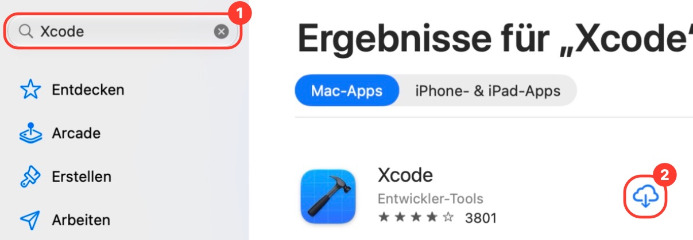
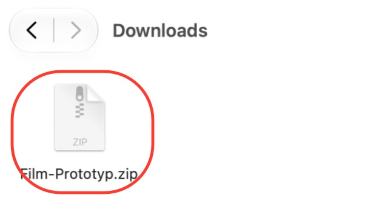
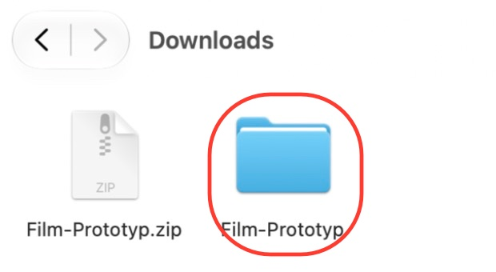
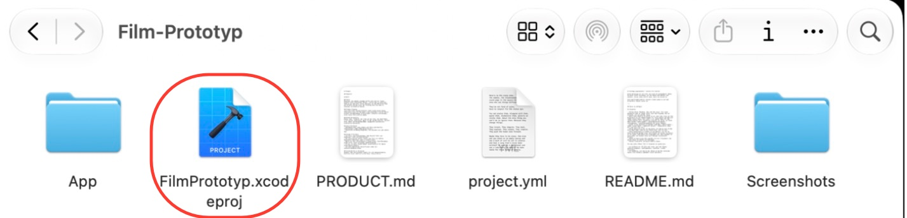
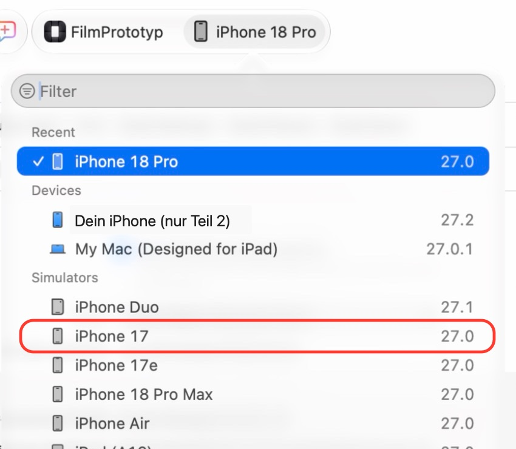
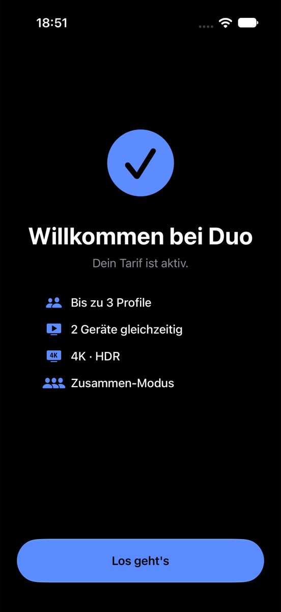
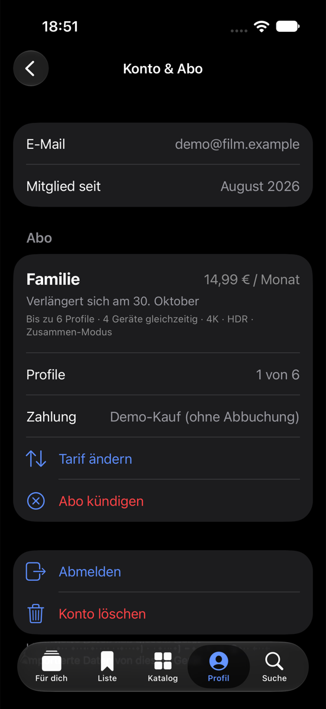
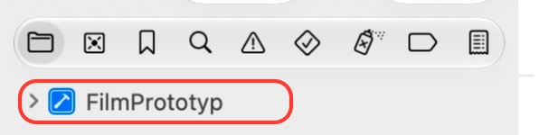
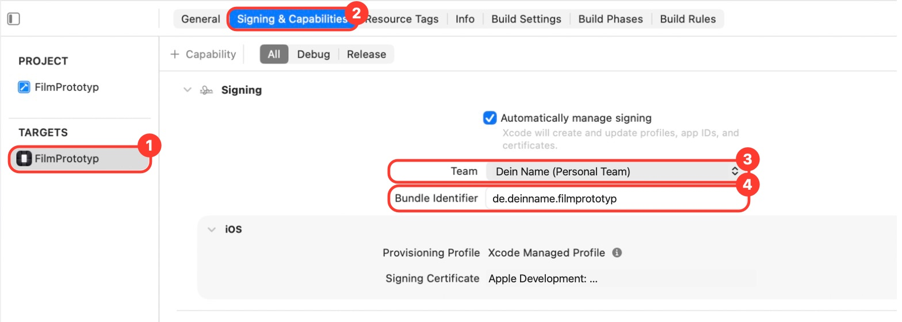

<div align="center">

# 🎬 Film-App ausprobieren

**Ein Film statt tausend Kacheln.** So bekommst du die App auf deinen Mac oder dein iPhone.<br>
Du musst nichts über Programmieren wissen. Mach einfach einen Schritt nach dem anderen.

</div>

> [!TIP]
> Lies jeden Schritt **ganz**, bevor du klickst. Fett geschriebene Wörter (**so**) stehen genau so auf deinem Bildschirm.

**Apple TV:** Die native TV-App liegt im selben Xcode-Projekt als Scheme **FilmTV**. Start, gemeinsames Design, Server-Einrichtung und Prüfstand stehen in [Apple-TV-Anleitung](docs/apple-tv.md).

**Inhalt**
- [✅ Bevor du anfängst](#-bevor-du-anfängst)
- [💻 Teil 1: Auf dem Mac ausprobieren](#-teil-1-auf-dem-mac-ausprobieren) (hier anfangen)
- [📱 Teil 2: Auf dein iPhone bringen](#-teil-2-auf-dein-iphone-bringen)
- [🔄 Neue Version holen](#-neue-version-holen)
- [🆘 Wenn etwas nicht klappt](#-wenn-etwas-nicht-klappt)

---

## ✅ Bevor du anfängst

| Du brauchst | So prüfst du es |
|---|---|
| 💻 **Einen Mac** (MacBook, iMac, Mac mini) | Windows-PCs gehen leider nicht. Das Programm gibt es nur für den Mac. |
| 🆕 **macOS 26.6 oder neuer** | Oben links auf das **Apfel-Symbol** → **Über diesen Mac**. Ist die Zahl kleiner: Apfel-Symbol → **Systemeinstellungen** → **Allgemein** → **Softwareupdate**. |
| 💾 **Etwa 40 GB freien Speicher** | Apfel-Symbol → **Über diesen Mac** → **Weitere Infos** → **Speicher** |
| 🍎 **Eine Apple-ID** | Damit lädst du auch Apps im App Store. Wer ein iPhone hat, hat eine. |
| 📦 **Die App** | Kommt in Schritt 3, ein Klick genügt. Ein GitHub-Konto brauchst du **nicht**. |
| ⏱️ **1 bis 2 Stunden Zeit** | Das meiste ist Warten auf Downloads. Am besten im WLAN. |

**Nur für Teil 2 (echtes iPhone):** ein iPhone mit **iOS 26 oder neuer** (**Einstellungen** → **Allgemein** → **Info**) und ein **Kabel** zum Mac.

---

## 💻 Teil 1: Auf dem Mac ausprobieren

Die App läuft hier in einem **Spiel-iPhone**: ein Fenster auf deinem Mac, das wie ein iPhone aussieht. Du brauchst dafür kein echtes iPhone.

### Schritt 1 · Xcode laden

*Xcode ist ein kostenloses Programm von Apple. Wir brauchen es nur als Startknopf, du musst darin nichts programmieren.*

1. Drück auf der Tastatur gleichzeitig **⌘ cmd** und die **Leertaste**. Tippe `App Store` und drück **↩ Enter**.
2. Klick links oben in das Suchfeld ①, tippe `Xcode` und drück **↩ Enter**.
3. Klick bei **Xcode** (blaues Symbol mit Hammer) auf **Laden** ②. Hast du Xcode schon einmal geladen, ist dort eine **Wolke**.
4. Vielleicht fragt der Mac nach deinem Apple-ID-Passwort. Gib es ein.



> [!NOTE]
> ☕ **Jetzt warten.** Xcode ist über 10 GB groß. Das dauert 30 Minuten bis über eine Stunde. Du kannst nebenbei etwas anderes machen.

### Schritt 2 · Xcode zum ersten Mal öffnen

1. Ist der Download fertig, steht im App Store **Öffnen**. Klick darauf.
2. Kommen Vertragsbedingungen: auf **Agree** klicken und dein **Mac-Passwort** eingeben (das, mit dem du den Mac entsperrst).
3. Xcode fragt, wofür du Apps bauen willst. Setz einen Haken bei **iOS** und klick auf **Download & Install**.
4. **Wieder warten**, bis der Balken voll ist (10 bis 30 Minuten). Das Fenster danach kannst du offen lassen.

### Schritt 3 · Die App auspacken

1. Klick hier: **[⬇️ Film-Prototyp.zip herunterladen](https://github.com/Skyfall91/Film-Prototyp/releases/latest/download/Film-Prototyp.zip)**<br>
   Der Download startet sofort und landet im Ordner **Downloads**. (Fragt der Browser nach, auf **Erlauben** klicken.)
2. Öffne den **Finder** (das blau-weiße Gesicht unten links im Dock) und klick links auf **Downloads**.
3. Mach einen **Doppelklick** auf **`Film-Prototyp.zip`**.



4. Daneben erscheint ein blauer Ordner **Film-Prototyp**. Mach einen **Doppelklick** darauf.



### Schritt 4 · Das Projekt öffnen

1. Im Ordner ist eine Datei **`FilmPrototyp.xcodeproj`** mit blauem Hammer-Symbol. Mach einen **Doppelklick** darauf.



2. Xcode öffnet ein großes Fenster. **Keine Angst**, du brauchst davon nur zwei Knöpfe.
3. Fragt Xcode **Trust and Open?**, klick auf **Trust and Open**.
4. Oben in der Mitte steht kurz **Packages** oder **Fetching**. Xcode lädt ein kleines Zusatzteil. **Warte, bis es weg ist** (meist unter einer Minute).

### Schritt 5 · Spiel-iPhone wählen und starten

Ganz oben im Xcode-Fenster sind die zwei Knöpfe, die du brauchst:


1. Klick oben rechts auf den **Gerätenamen** ①. Es klappt eine Liste auf.
2. Wähl unter **Simulators** ein iPhone, zum Beispiel **iPhone 17**. (Bei dir können die Namen etwas anders sein. Irgendein iPhone geht.)



3. Klick auf den **Play-Knopf ▶** ②.
4. Beim ersten Mal dauert es ein paar Minuten (oben steht **Building**). Dann öffnet sich das Spiel-iPhone und die App startet. 🎉

> [!TIP]
> **So bedienst du das Spiel-iPhone:** Klicken = Tippen · Klicken, halten und ziehen = Wischen.<br>
> **Aufhören:** in Xcode auf das Quadrat **■** neben Play klicken.<br>
> **Nächstes Mal:** Xcode öffnen → Projekt öffnen (Schritt 4) → **▶**.

### Was du in der App eingeben kannst

| | |
|---|---|
| 🔑 **Konto erstellen** | Eine **ausgedachte** E-Mail reicht, z. B. `dein-name@test.de`, dazu ein Passwort mit mindestens 8 Zeichen und einer Zahl. Es wird nichts verschickt. Das Konto liegt online, du kannst dich damit auch auf einem anderen iPhone anmelden. Merk dir das Passwort: Nach dem Abmelden brauchst du es wieder. |
| 💳 **Abo** | Ist ein **Demo-Kauf**. Du zahlst nichts und gibst keine Bankdaten ein. |
| 🎞️ **Filme** | Statt echter Filme laufen Trailer von YouTube. Dafür brauchst du Internet. |

<p align="center">




</p>

---

## 📱 Teil 2: Auf dein iPhone bringen

Mach zuerst **Teil 1 bis Schritt 4**.

### Schritt 1 · Apple-ID in Xcode eintragen

1. Oben am Bildschirm in der Menüleiste auf **Xcode** → **Settings…** klicken.
2. Oben auf **Accounts** klicken.
3. Unten links auf **+** → **Apple ID** → **Continue**.
4. Mit deiner **Apple-ID** anmelden (dieselbe wie im App Store).
5. Fenster mit dem **roten Punkt** oben links schließen.

### Schritt 2 · Die App auf deinen Namen umstellen

*Jede App auf einem iPhone braucht einen Besitzer und einen eigenen Namen. So machst du sie zu deiner.*

1. Klick im Xcode-Fenster **links oben** auf das blaue **FilmPrototyp**.
   (Ist links keine Spalte? Drück **⌘ cmd** + **0**.)



2. In der Mitte unter **TARGETS** auf **FilmPrototyp** klicken ①.
3. Oben auf den Reiter **Signing & Capabilities** klicken ②.
4. Bei **Team** auf das Feld klicken und **deinen Namen (Personal Team)** wählen ③.
5. Bei **Bundle Identifier** ④ in das Feld klicken und **`beispiel`** durch deinen Namen ersetzen, z. B. `de.maxmuster.filmprototyp`. Danach **↩ Enter**.



> [!IMPORTANT]
> Im Bundle Identifier nur **kleine Buchstaben**, **keine Leerzeichen**, **keine Umlaute** (ä ö ü) und **kein ß**.<br>
> Steht danach **keine rote Meldung** mehr da, hat es geklappt.

### Schritt 3 · iPhone verbinden

1. Steck das iPhone mit dem **Kabel** an den Mac und entsperr es.
2. Auf dem iPhone: **Diesem Computer vertrauen?** → **Vertrauen** → iPhone-Code eingeben.

### Schritt 4 · Entwicklermodus einschalten

*Damit darf das iPhone Apps starten, die nicht aus dem App Store kommen.*

1. iPhone: **Einstellungen** → **Datenschutz & Sicherheit** → ganz nach unten → **Entwicklermodus**.
2. Schalter **an** → **Neustart**.
3. Nach dem Neustart noch einmal **Einschalten** antippen und den Code eingeben.

> [!NOTE]
> Kein **Entwicklermodus** zu sehen? Mach erst Schritt 5 einmal, danach taucht er auf.

### Schritt 5 · Starten

1. In Xcode oben auf den **Gerätenamen** klicken (wie in Teil 1, Schritt 5) und unter **Devices** **dein iPhone** wählen.
2. Auf **▶** klicken.
3. Steht auf dem iPhone **Nicht vertrauenswürdiger Entwickler**:
   **Einstellungen** → **Allgemein** → **VPN & Geräteverwaltung** → deine Apple-ID → **Vertrauen**.
4. Noch einmal **▶** klicken. Die App startet auf deinem iPhone. 🎉 Jetzt kannst du das Kabel abziehen.

> [!WARNING]
> Mit einer kostenlosen Apple-ID läuft die App **nur 7 Tage**. Danach: iPhone anstecken, Xcode und Projekt öffnen, **▶** klicken.

---

## 🔄 Neue Version holen

*Gibt es eine neue Version, tauschst du einfach den Ordner aus. Dein Konto, deine Profile und Bewertungen bleiben erhalten. Der Download-Link liefert immer automatisch den neuesten Stand.*

1. Xcode ganz schließen (**⌘ cmd** + **Q**).
2. Den alten Ordner **Film-Prototyp** und die alte **`Film-Prototyp.zip`** in den **Papierkorb** ziehen.
3. Die neue Version laden: **[⬇️ Film-Prototyp.zip herunterladen](https://github.com/Skyfall91/Film-Prototyp/releases/latest/download/Film-Prototyp.zip)**
4. Weiter wie in **Teil 1, Schritt 3 bis 5**: auspacken, **`FilmPrototyp.xcodeproj`** öffnen, **▶** klicken.

**Auf dem iPhone** machst du danach noch einmal **Teil 2, Schritt 2** und dann **Schritt 5**. Schritt 1, 3 und 4 sind schon erledigt.

> [!IMPORTANT]
> Trag beim **Bundle Identifier** genau **denselben** Namen ein wie beim ersten Mal. Dann ersetzt Xcode die alte App auf dem iPhone. Bei einem neuen Namen hast du die App zweimal, und die neue fängt bei null an.

> [!TIP]
> Dein Konto liegt online. Selbst wenn etwas schiefgeht: einfach mit deiner E-Mail und deinem Passwort wieder anmelden, dann ist alles wieder da.

---

## 🆘 Wenn etwas nicht klappt

| Was du siehst | Was du tust |
|---|---|
| Xcode lässt sich nicht laden („nicht kompatibel“) | macOS ist zu alt → zuerst updaten (siehe [Bevor du anfängst](#-bevor-du-anfängst)). |
| „Nicht genügend Speicherplatz“ | Fotos, Videos oder alte Programme löschen oder verschieben. |
| Keine iPhones in der Geräteliste | Xcode lädt noch iOS. Warten. Sonst: **Xcode** → **Settings…** → **Components** → bei **iOS** auf **Get**. |
| Rot: **No such module 'YouTubeKit'** | Kurz warten. Sonst: Menü **File** → **Packages** → **Reset Package Caches**, dann **▶**. |
| Rot: **…requires a development team** | Teil 2, Schritt 2: bei **Team** deinen Namen wählen. |
| Rot: **Failed to register bundle identifier** | Name schon vergeben. Eine Zahl anhängen, z. B. `de.maxmuster2.filmprototyp`. |
| Dein iPhone ist nicht in der Liste | Kabel neu einstecken, iPhone entsperren, **Vertrauen** tippen. |
| App öffnet sich auf dem iPhone nicht mehr | Die 7 Tage sind um → iPhone anstecken, **▶** klicken. |
| Statt Bildern nur graue Karten mit Titeln | Die Filmbilder laden beim ersten Start aus dem Internet. Internet prüfen und kurz warten. |
| Video lädt nicht | Internet prüfen. |

**Hilft alles nichts?** Mach ein Bildschirmfoto (**⌘ cmd** + **⇧ Shift** + **3**, es liegt dann auf dem Schreibtisch) und schick es an die Person, von der du den Link hast.

<br>

---
---

## 🛠 Für Entwickler

Alles ab hier brauchst du **nicht**, um die App auszuprobieren.

Klickbarer iOS-Prototyp für den Pitch im Modul *Modellierung von Anwendungssystemen* (TH Köln, WS 2026/27).

**Idee:** Ein Film statt tausend Kacheln. Die App lernt im Onboarding per Swipe deinen Geschmack und schlägt dir dann genau einen passenden Film (oder eine Serie) vor.

### Bauen

```bash
xcodegen generate   # nur nötig, wenn project.yml geändert wurde
open FilmPrototyp.xcodeproj
```

SwiftUI, iOS 26, Xcode 26 oder neuer. Signiert wird mit dem Personal Team, daher läuft die App 7 Tage und muss danach neu installiert werden.

### Funktionen

| Bereich | Was passiert |
|---|---|
| Konto | Online-Konten über Supabase (Server in Frankfurt): Registrieren und Anmelden mit E-Mail und Passwort, der Stand (Profile, Bewertungen, Merkliste) liegt je Konto online und kommt auf jedem Gerät per Login zurück. Jedes Konto sieht nur seine eigenen Daten (Row Level Security). Ohne Netz zählt die Konten-Datenbank auf dem Gerät (SwiftData). Abmelden, Konto löschen online und auf dem Gerät (DSGVO) |
| Abo | Tarife Solo / Duo / Familie (2 / 4 / 8 Profile, 1 / 2 / 4 gleichzeitige Geräte, Zusammen-Modus ab Duo; 4K in allen). Bei einem Downgrade werden überzählige Profile pausiert, nicht gelöscht, und lassen sich gegen ein aktives tauschen. Abo-Wahl nach dem Geschmacksprofil, 7 Tage gratis, Demo-Kauf ohne Zahlungsdaten, Tarif wechseln/kündigen. Ohne Abo: Trailer und Vorschläge ja, Abspielen nein |
| Wer schaut? | Startbildschirm bei mehreren Profilen, mehrere antippen = Zusammen-Modus |
| Profil erstellen | Avatar-Galerie nach Genres, Name, Kinderprofil mit FSK-Stufe |
| Serien | 48 Serien mit Staffeln und Folgen, „Weiterschauen“ pro Profil, Filter Film/Serie auf der Startseite und im Katalog |
| Onboarding | Profil → bekannte Filme swipen (← nicht meins, → mag ich, ↑ Lieblingsfilm, ↓ nicht gesehen) → optional Letterboxd/IMDb-CSV importieren → Geschmacksprofil (Satz von Apple Intelligence) |
| Für dich | Ein Vorschlag mit Match-% („für euch beide“ im Zusammen-Modus) und genau einem Satz zum Film, die Begründung steht in den Details. ← heute nicht · → merken · ↓ schon gesehen · ↑ Details · Rückgängig-Button · Zeitfilter |
| Profilwahl | Liquid-Glass-Menü wie bei Apple TV: mehrere Profile gleichzeitig wählen (Zusammen-Modus, „least misery“, strengste FSK), Profil erstellen |
| Profil | Geschmacksprofil, „Weiter swipen“ zum Verfeinern, Chat mit Apple Intelligence („Musicals nerven mich, ruhige Sci-Fi liebe ich“) |
| Bewertung | Nach dem Schauen bewertet jedes Profil einzeln (4 Stufen + optional Review) |
| Stimmungssuche | Freitext → Apple Intelligence (on-device, `FoundationModels`) übersetzt in Filter → Suche im eigenen Index. Ohne AI: Stichwortsuche |
| Wiedergabe | „Abspielen“ = Trailer als Film, im nativen iOS-Player (AVPlayerViewController, 1080p, dreht ins Querformat). YouTube-Stream wird per YouTubeKit aufgelöst |
| Trailer-Auswahl | Pro Film bis zu 4 offizielle Trailer (Studio-Kanäle, deutsch zuerst, sonst OV), keine KinoCheck-Uploads |
| Bewertungen | IMDb, Rotten Tomatoes und Metacritic auf Karte und Liste, in den Details als Links (plus Letterboxd) |
| SharePlay | Knopf in den Details mit Vorschau, wie gemeinsames Schauen aussähe. Nur angedeutet: echtes SharePlay braucht das bezahlte Entwicklerprogramm |
| Katalog / Merkliste | bewusst als Nebenweg |

### Architektur (für die Modellierung)

- `Model/`: `Film`, `Profile`, `Interaction`, `AppStore` (Zustand + JSON-Persistenz)
- `Model/CloudAccounts`: Online-Konten (Supabase Auth und eine Tabelle `account_state`), Sitzung im Schlüsselbund
- `Model/AccountDatabase`: Konten-Datenbank auf dem Gerät (SwiftData), für ohne Netz und den schnellen Kontowechsel
- `Model/Account`: Konto, Tarif (`Plan`), `Subscription`, `PurchaseService` (StoreKit 2 mit Demo-Kauf als Rückfall) → später **Strategy**/**Adapter** für Zahlungsanbieter
- `Engine/RecommendationEngine`: Hybrid: Matrix-Faktorisierung aus MovieLens (Filmbonus + 24 Geschmacksfaktoren) + IMDb + inhaltsbasiertes Modell (Genre, Stimmung, Regie, Cast)
- `Engine/MoodSearch`: austauschbare KI-Komponente (Apple Intelligence ↔ Stichwort-Fallback) → später **Strategy**
- `Engine/LibraryImport`: Letterboxd/IMDb-CSV → später **Adapter**
- `Views/SwipeCard`: generische 4-Richtungs-Swipe-Karte

### Daten

`App/Resources/films.json`: 369 Filme und 48 Serien (Staffeln/Folgen von OMDb). Ursprünglich 124 Filme, Blockbuster bis 2026, bewusst auch sehr gut und sehr schlecht bewertete Filme (zum Testen der Empfehlung), 34 Geheimtipps für Filmfans (`niche`) und 2 „Demnächst“. Alle Beschreibungen sind handgeschrieben und spoilerfrei; fehlt eine, schreibt Apple Intelligence einen Anreißer nur aus den Metadaten. Das Onboarding mischt beide Gruppen bei jedem Start neu. Metadaten und Bewertungen kommen von OMDb. Poster liegen aus Urheberrechtsgründen **nicht** im Repo: `films.json` enthält nur ihre Adresse, die App lädt sie beim ersten Start und speichert sie auf dem Gerät (`PosterCache`). Trailer stammen von offiziellen Studio-Kanälen auf YouTube. Deutsche Titel, FSK, Stimmungs-Tags und Kurzbeschreibungen sind von Hand ergänzt (Demo-Daten).

### Demo- und Screenshot-Modus

Startparameter für Demos und Folien-Screenshots (in Xcode unter *Scheme → Run → Arguments*):

| Parameter | Wirkung |
|---|---|
| `-seedDemo YES` | fertiges Demo-Profil, Startseite |
| `-pendingRating YES` | mit Bewertungs-Banner |
| `-screen calibrate` (oder `reveal`, `detail`, `rating`, `player`, `editor`, `plan`, `who`, `account`, `register`, `login`) | öffnet direkt diesen Screen |
| `-detailID serie-dark` | bestimmter Titel in der Detailansicht |
| `-kind series` | Startseite nur Serien |
| `-palette honig` (oder `minze`, `rosa`, `profil`) | Farbvarianten, Standard ist `profil` |
| `-startTab 4 -moodQuery "Düster und spannend"` | Suche mit Beispieltext |


> Hinweis: Das Auflösen von YouTube-Streams (YouTubeKit) ist nur für diesen Studien-Prototyp gedacht. Ein echtes Produkt würde lizenzierte Videodateien von einem eigenen CDN streamen.
